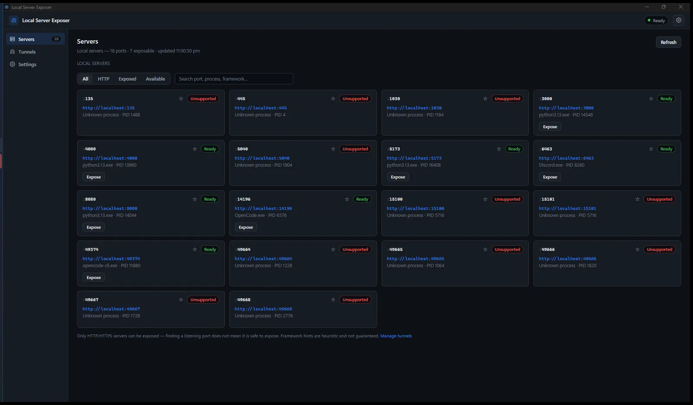
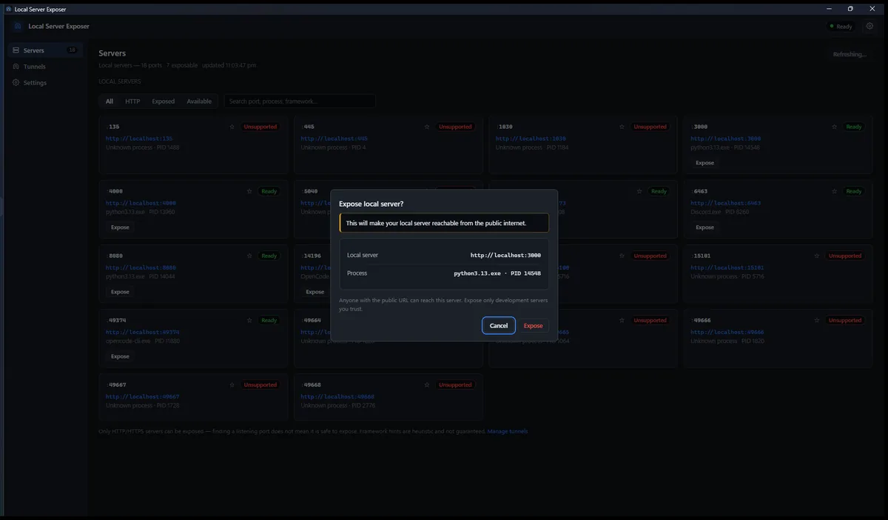
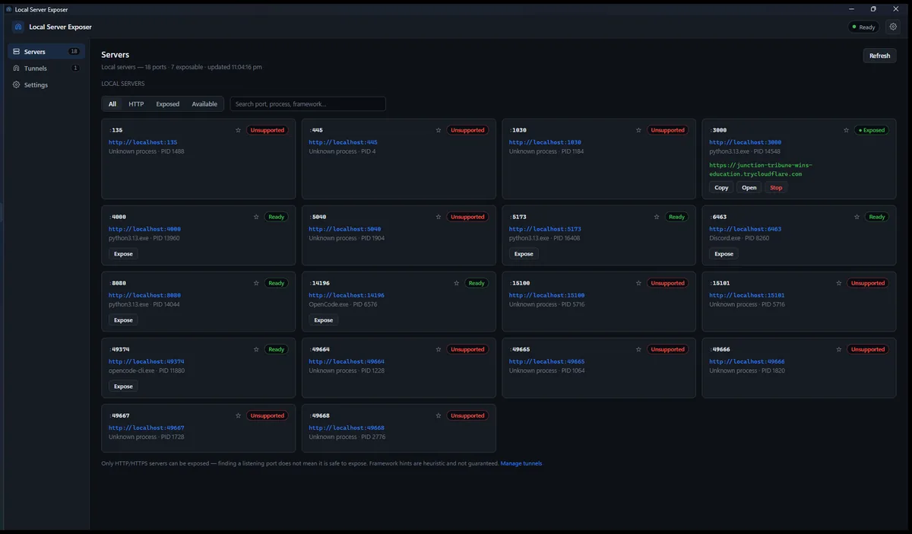
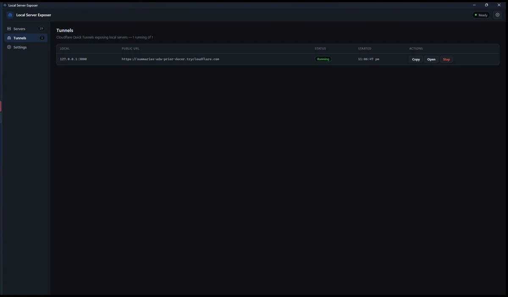
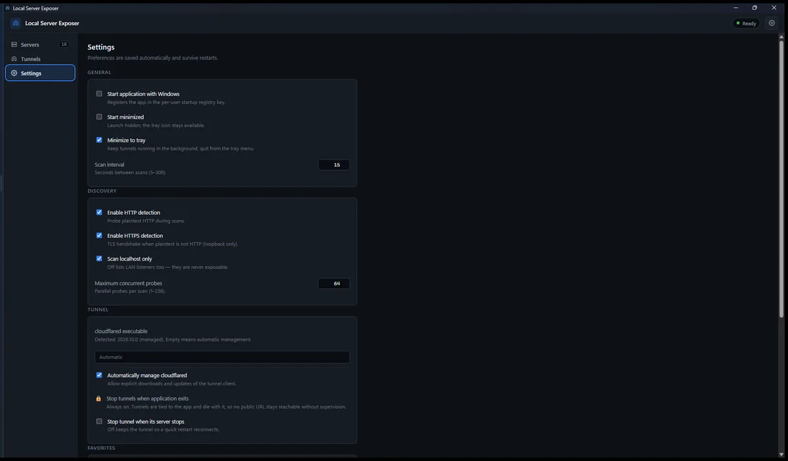

<div align="center">


# Local Server Exposer

**Share your local development server with the world — without a router, a port
forward, or a public IP.**

A lightweight Windows desktop app that finds the HTTP servers running on your
machine and exposes selected ones through **Cloudflare Quick Tunnels**.

🌐 **Website:** <https://palashsuryavanshi.github.io/localserverexposer_public/>

[](https://palashsuryavanshi.github.io/localserverexposer_public/installation.html)
[](https://github.com/palashsuryavanshi/localserverexposer_public/releases/latest)
[-8A8A8A)](LICENSE)

[](https://rookieenough.github.io/Orion-Data/redirect.html?id=local-server-exposer&icon=https%3A%2F%2Fraw.githubusercontent.com%2Fpalashsuryavanshi%2Flocalserverexposer_public%2Fmain%2Fdocs%2Fassets%2Fapp-icon.png)

**[⬇ Download for Windows](https://github.com/palashsuryavanshi/localserverexposer_public/releases/download/v1.0.0/LocalServerExposer_1.0.0_x64-setup.exe)** · [Install guide](https://palashsuryavanshi.github.io/localserverexposer_public/installation.html) · [Get started](https://palashsuryavanshi.github.io/localserverexposer_public/getting-started.html) · [Troubleshooting](https://palashsuryavanshi.github.io/localserverexposer_public/troubleshooting.html) · [Security](https://palashsuryavanshi.github.io/localserverexposer_public/security.html)

</div>

---

## What it does

- **Automatic discovery** — enumerates your machine's IPv4 listening sockets
  through the native Windows TCP table and shows the owning process for each.
- **Honest classification** — each port is probed and labelled *Ready* (speaks
  HTTP/HTTPS), *Unsupported* (speaks something else), or *Unreachable*, with a
  plain-language reason. Only HTTP/HTTPS servers can be exposed; anything else
  is refused by the app itself.
- **One-click Quick Tunnels** — exposes the selected port at an ephemeral
  `https://….trycloudflare.com` URL, with copy, open-in-browser and stop.
- **Confirmation before every exposure** — including retries. There is no
  "don't ask again" option, on purpose.
- **Multiple tunnels at once** — each is independent; stopping one leaves the
  others running.
- **Never leaves a tunnel behind** — tunnels are tied to the app: they are
  stopped when it exits, and cannot survive a crash or sign-out.
- **System tray** — close the window and it keeps running in the background;
  stop all tunnels or quit from the tray menu.
- **Desktop notifications** — when a tunnel goes live or fails.
- **Favorites, search and filters** — star the ports you use, search by port,
  process name or detected framework, filter by HTTP / exposed / available.
- **Settings that persist** — scan interval, discovery options, favorites,
  start-with-Windows, and where to find the tunnel client.

## Screenshots

| Servers | Confirmation | Running tunnel | Tunnels | Settings |
|---|---|---|---|---|
|  |  |  |  |  |

<sub>Captured from version 1.0.0. The Quick Tunnel URL visible in the
"app-tunnel" image belonged to a tunnel that was stopped immediately
after the capture.</sub>

## Quick start

1. **Start a local server** — for example a dev server on `http://localhost:3000`.
2. **Open the app.** Within a few seconds the port appears as a card showing
   `http://localhost:3000`, the owning process, and the status **Ready**.
3. **Click Expose** and read the confirmation dialog. Confirm.
4. **Wait for the URL.** The card shows *Starting*, then the public
   `https://….trycloudflare.com` address once the tunnel is actually serving.
5. **Copy or open the URL**, then **Stop** when you are done.

Full walkthrough: [Get started](https://palashsuryavanshi.github.io/localserverexposer_public/getting-started.html).

## Download

Latest stable release: **v1.0.0** — `LocalServerExposer_1.0.0_x64-setup.exe`
(2.78 MB, per-user install, no administrator rights).

- [Download the installer](https://github.com/palashsuryavanshi/localserverexposer_public/releases/download/v1.0.0/LocalServerExposer_1.0.0_x64-setup.exe)
- [All releases and checksums](https://github.com/palashsuryavanshi/localserverexposer_public/releases)
- [Installation instructions](https://palashsuryavanshi.github.io/localserverexposer_public/installation.html)

Verify the download against the published `SHA256SUMS.txt`; every release is
re-checked automatically by a workflow after publication.

## Security warning

**Exposing a server makes it reachable from the public internet.** Anyone
holding the tunnel URL can reach your local service until you stop the tunnel.
Only expose development servers you trust, on machines you control, and stop
tunnels when done. Quick Tunnel URLs are unguessable but bearer-access — treat
them accordingly.

The app has no telemetry or analytics, redacts tunnel URLs before writing logs,
and has been through an internal threat-model review. It has **not** been
penetration tested or certified by a third party, and its binaries are **not
code-signed** (SmartScreen will warn on first run).

More detail: [security and privacy](https://palashsuryavanshi.github.io/localserverexposer_public/security.html).

## About this repository

This repository is the **public download portal and website** for Local Server
Exposer. It contains documentation, screenshots and release downloads. The
application is distributed as a compiled binary; **its source code is not
publicly available.**

- Website: <https://palashsuryavanshi.github.io/localserverexposer_public/>
- Website source: [`website/`](website) — templates, styles, scripts, config
- Built site: [`docs/`](docs) — generated output, served with GitHub Pages
- Issues and feature requests: [GitHub issues](https://github.com/palashsuryavanshi/localserverexposer_public/issues)
- How contributions are handled: [CONTRIBUTING.md](CONTRIBUTING.md)

### Working on the website

`docs/` is generated — do not edit it by hand. Edit the sources in
`website/`, then rebuild:

```bash
cd website
npm install      # no dependencies, but enables the scripts
npm run build    # render docs/
npm run check    # links, assets, headings, alt text, landmarks
npm test         # template engine unit tests
npm run dev      # build and serve on http://localhost:4321
```

Every repository URL, product fact and page section lives in
[`website/site.config.js`](website/site.config.js). Release metadata is read
from the public GitHub Releases API at build time and refreshed in the browser;
if it cannot be retrieved the page falls back to linking the releases page rather
than showing a made-up version. See [`website/README.md`](website/README.md) for
the full description.

## License

Proprietary — all rights reserved. See [LICENSE](LICENSE). cloudflared is ©
Cloudflare, Inc. (Apache-2.0) and is downloaded separately at the user's
request; it is not redistributed here.