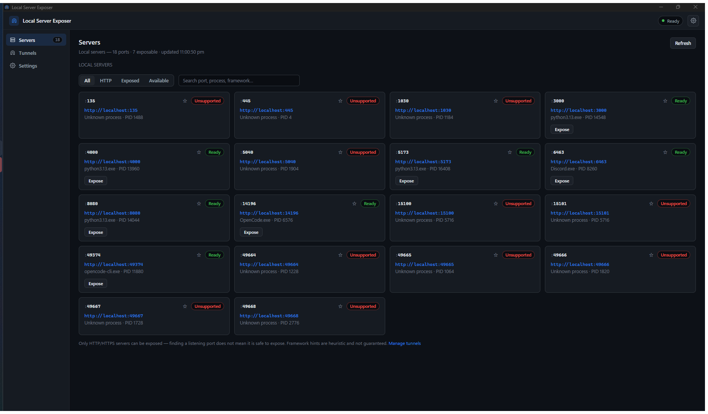
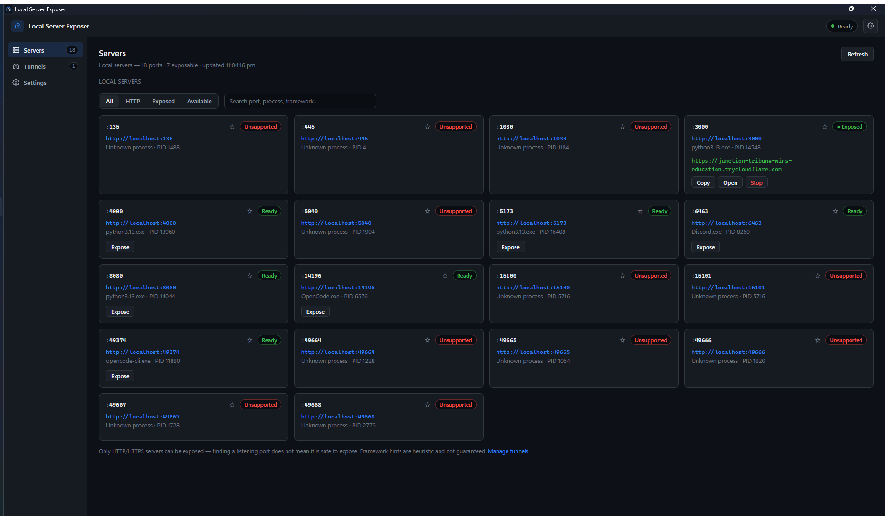
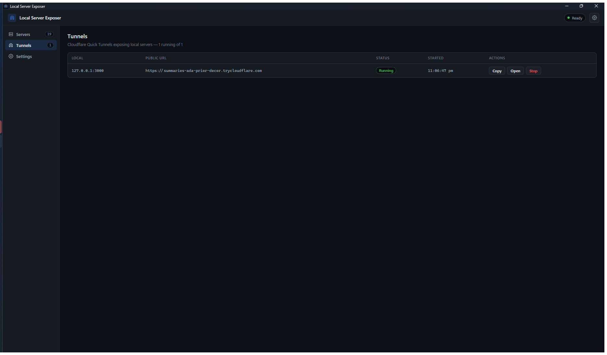
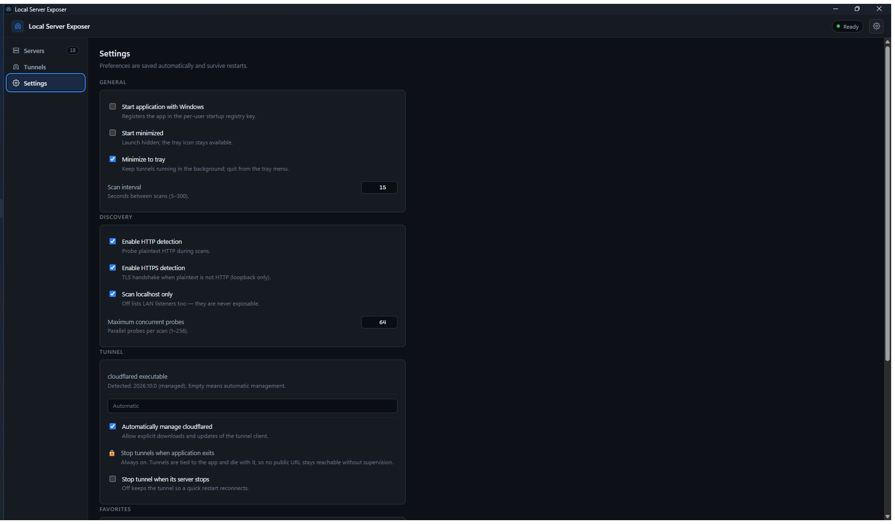

# Local Server Exposer

**Share your local development server with the world — without a router, a
port forward, or a public IP.**

A lightweight Windows desktop app that finds the HTTP servers running on your
machine and gives selected ones a public `https://….trycloudflare.com` URL
through Cloudflare Quick Tunnels.

[-8A8A8A)](LICENSE)

[Download for Windows](#-download-for-windows) · [Documentation](docs/getting-started.md) · [Troubleshooting](docs/troubleshooting.md) · [Security](docs/privacy-and-security.md) · [Releases](https://github.com/palashsuryavanshi/localserverexposer_public/releases)

---

## The problem

You started a dev server on `localhost:3000`. A client, a teammate on another
network, or a webhook needs to reach it. The usual answers are all awkward:
tunnel CLIs, router port forwarding, or deploying a preview build somewhere
else. Each one means a separate tool, a separate tab, and URLs you have to keep
track of by hand.

Local Server Exposer puts that in one small desktop app: it lists what is
actually listening on your machine, and one click turns a chosen server into a
public HTTPS URL.

## Screenshots

**Discover local servers** — every loopback listener, classified, with the
process that owns it:

**Exposure is never accidental** — every new tunnel asks for confirmation first:

**A live tunnel** — the public URL appears only after the tunnel is actually
serving, with copy / open / stop controls:

**All tunnels in one place:**

**Settings** — scan tuning, cloudflared management, favorites:

Screenshots are from version 1.0.0. The Quick Tunnel URL visible in the
"screenshot-tunnel" image belonged to a tunnel that was stopped immediately
after the capture.

## Features

- **Automatic discovery** — enumerates your machine's IPv4 listening sockets
  through the native Windows TCP table and shows the owning process for each.
- **Honest classification** — each port is probed and labelled *Ready* (speaks
  HTTP/HTTPS), *Unsupported* (speaks something else), or *Unreachable*, with a
  plain-language reason. Only HTTP/HTTPS servers can be exposed; anything else
  is refused by the app itself.
- **One-click Quick Tunnels** — exposes the selected port at an ephemeral
  `https://….trycloudflare.com` URL, with copy, open-in-browser and stop.
- **Confirmation before every exposure** — including retries. There is no
  "don't ask again" option, on purpose.
- **Multiple tunnels at once** — each is independent; stopping one leaves the
  others running.
- **Never leaves a tunnel behind** — tunnels are tied to the app: they are
  stopped when it exits, and cannot survive a crash or sign-out.
- **System tray** — close the window and it keeps running in the background;
  stop all tunnels or quit from the tray menu.
- **Desktop notifications** — when a tunnel goes live or fails.
- **Favorites, search and filters** — star the ports you use, search by port,
  process name or detected framework, filter by HTTP / exposed / available.
- **Settings that persist** — scan interval, discovery options, favorites,
  start-with-Windows, and where to find `cloudflared`.
- **Framework hints** — best-effort detection (for example Next.js, Vite,
  Express) shown next to a server so you know what you are about to share.

## Download for Windows

**Latest stable release:** [v1.0.0](https://github.com/palashsuryavanshi/localserverexposer_public/releases/tag/v1.0.0)

1. Go to the [Releases page](https://github.com/palashsuryavanshi/localserverexposer_public/releases).
2. Download [**`LocalServerExposer_1.0.0_x64-setup.exe`**](https://github.com/palashsuryavanshi/localserverexposer_public/releases/download/v1.0.0/LocalServerExposer_1.0.0_x64-setup.exe) (about 2.8 MB).
3. Optionally verify the download against the published `SHA256SUMS.txt`.
4. Run the installer. It is a **per-user install**: no administrator prompt, no
   system-wide changes.
5. Launch **Local Server Exposer** from the Start Menu.

Full instructions, including verification and manual-install notes, are in
[docs/installation.md](docs/installation.md).

> The application is distributed as a compiled Windows binary. **Its source
> code is not publicly available.** This repository contains documentation and
> release downloads only.

## Quick start

1. **Start a local server** — for example a dev server on `http://localhost:3000`.
2. **Open the app.** Within a few seconds the port appears as a card showing
   `http://localhost:3000`, the owning process, and the status **Ready**.
3. **Click Expose** and read the confirmation dialog. Confirm.
4. **Wait for the URL.** The card shows *Starting*, then the public
   `https://….trycloudflare.com` address once the tunnel is actually serving.
5. **Copy or open the URL**, then **Stop** when you are done.

A fuller walkthrough, including what happens while a tunnel is running, is in
[docs/getting-started.md](docs/getting-started.md).

## System requirements

| | |
|---|---|
| Operating system | Windows 10 or 11, **x64** (ARM64 is not supported) |
| Memory | ~40 MB for the app itself; the WebView2 runtime adds roughly 300 MB |
| Disk | ~2.8 MB for the installer; the app itself is small |
| Other software | [Microsoft Edge WebView2 Runtime](https://developer.microsoft.com/microsoft-edge/webview2/) — already present on Windows 10/11. The installer offers to fetch it if it is missing. |
| Internet access | Required only when you start a tunnel, and once to download the `cloudflared` client (~55 MB) |
| Administrator rights | Not required |

## Security considerations

**Exposing a server makes it reachable from the public internet.** Read this
before you click Expose.

- A Quick Tunnel URL is **unguessable but bearer-access**: anyone who has the
  link can reach your server until you stop the tunnel. Treat it like a secret
  you would paste into a chat message.
- **Only expose development servers you trust**, on a machine you control. Do
  not expose databases, admin panels, or anything holding real data.
- **The app confirms every exposure**, showing the exact port and process, and
  refuses to expose anything that does not speak HTTP/HTTPS.
- **Tunnels never outlive the app.** Stopping or crashing the application stops
  its tunnels.
- **The installer is not code-signed.** Windows SmartScreen may show a
  "Windows protected your PC" warning on first run. Choose *More info → Run
  anyway* only if you downloaded the file from this repository and its SHA-256
  matches the published checksum.
- **No telemetry.** The app has no analytics and no crash reporting to a
  third party. Local log files are kept with a 7-day retention and tunnel URLs
  are redacted before anything is written.

More detail, including the threat model and the known limitations, is in
[docs/privacy-and-security.md](docs/privacy-and-security.md).

## Troubleshooting

Quick answers to the things people hit most often. The full guide is in
[docs/troubleshooting.md](docs/troubleshooting.md).

| Symptom | What to do |
|---|---|
| No servers listed | Make sure your dev server is bound to `127.0.0.1`, then press **Refresh**. Check *Settings → Scan localhost only* if you expected LAN addresses to appear. |
| A port shows **Unsupported** | It is not speaking HTTP/HTTPS. That is by design: it cannot be exposed. |
| Expose fails, cloudflared missing | The tunnel client is downloaded on first use. Go to **Tunnels → Install cloudflared** (needs internet) or set an existing copy in Settings. |
| Tunnel stuck on **Starting** | Cloudflare edge registration normally takes a few seconds. After a minute the app reports the failure with a reason — check your connection, proxy or VPN. |
| **Tunnel failed** | Read the message on the card and press **Retry**. Common causes: no internet, a captive portal, or Cloudflare being unreachable. |
| SmartScreen warning | Expected: the binary is unsigned. Verify the checksum, then choose *More info → Run anyway*. |
| The app will not start | Install or repair the WebView2 Runtime, then relaunch. |

## Frequently asked questions

**Does it need my router configured?** No. Outbound connections only; no port
forwarding, no static IP, no router access.

**Is there a limit on how long a tunnel can stay up?** A Quick Tunnel stays up
as long as the app and the tunnel are running. There is no time limit in the
app; the URL changes if you restart the tunnel.

**Can I use a custom domain or my Cloudflare account?** Not in this version.
This app only creates anonymous Quick Tunnels.

**Can it expose a TCP service, database or SSH port?** No, and it will refuse
to try: exposure requires the target to answer as HTTP or HTTPS.

**Does it phone home or collect anything?** No telemetry, no analytics. See
[docs/privacy-and-security.md](docs/privacy-and-security.md).

**Why is the source code not here?** This repository is the public download and
documentation portal. The application is distributed as a compiled binary.

**Can I contribute?** Contributions are welcome as issues and discussions.
Please read [CONTRIBUTING.md](CONTRIBUTING.md) for how code changes are
handled, and note that the source is not hosted publicly.

## Links

- [Releases and downloads](https://github.com/palashsuryavanshi/localserverexposer_public/releases)
- [Installation guide](docs/installation.md)
- [Getting started](docs/getting-started.md)
- [Troubleshooting and FAQ](docs/troubleshooting.md)
- [Privacy and security](docs/privacy-and-security.md)
- [Report a bug](https://github.com/palashsuryavanshi/localserverexposer_public/issues/new?labels=bug)
- [Request a feature](https://github.com/palashsuryavanshi/localserverexposer_public/issues/new?labels=enhancement)

## Ownership and contact

Local Server Exposer is maintained by
[**palashsuryavanshi**](https://github.com/palashsuryavanshi).

- Bugs and feature requests: [GitHub issues](https://github.com/palashsuryavanshi/localserverexposer_public/issues)
- Security reports: open a private security advisory on this repository

## License

This repository contains public documentation and release assets. The
application itself is distributed as a proprietary compiled binary and carries
no open-source license — see [LICENSE](LICENSE).

