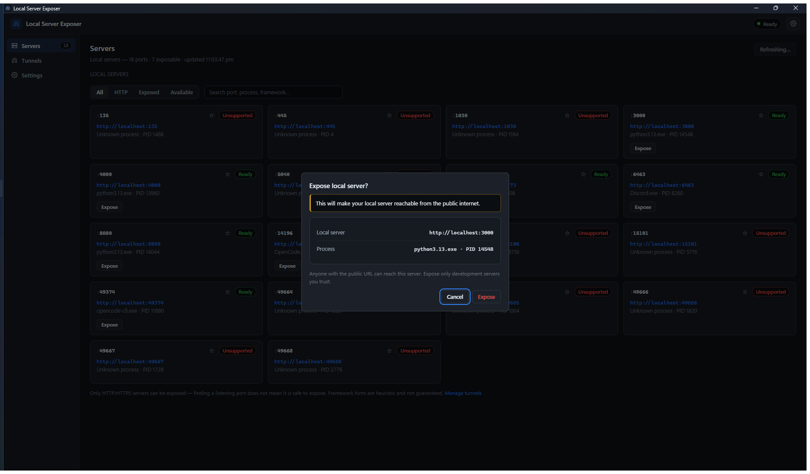

# Getting started

A five-minute tour: from "my dev server is running" to "here is a public URL".

- [The three pages](#the-three-pages)
- [1. Find your server](#1-find-your-server)
- [2. Expose it](#2-expose-it)
- [3. Share it](#3-share-it)
- [4. Stop it](#4-stop-it)
- [Reading the status labels](#reading-the-status-labels)
- [Finding things quickly](#finding-things-quickly)
- [Multiple servers at once](#multiple-servers-at-once)
- [Settings worth knowing](#settings-worth-knowing)

## The three pages

| Page | What it is for |
|---|---|
| **Servers** | Everything listening on your machine, with an *Expose* button for the ones that can be shared. |
| **Tunnels** | The tunnels you currently have running, with their public URLs. |
| **Settings** | Scan tuning, cloudflared management, favorites, autostart. |

The sidebar badge on **Tunnels** shows how many tunnels are running.

## 1. Find your server

Start your development server as usual — for example something listening on
`http://localhost:3000`. The Servers page refreshes on its own (every 15 seconds
by default); you can also press **Refresh**.

Each listener appears as a card:

- the **port**, and a clickable local address such as `http://localhost:3000`;
- the **process** that owns it (for example `node.exe · PID 14548`);
- a **status label**, and — for servers that answer HTTP — the response status,
  page title and a best-effort framework hint.

## 2. Expose it

1. Press **Expose** on a card marked **Ready**.
2. Read the confirmation dialog. It states plainly that the server becomes
   reachable from the public internet, and shows the exact URL and process.
   **Cancel is the focused button**, and Escape or clicking outside also cancels.
3. Press **Expose** to confirm.

   

There is no "remember my choice" option: every new exposure and every retry is
confirmed individually, so sharing is never a habit you acquire by accident.

While the tunnel starts, the card shows **Starting**. The public URL appears
only once the tunnel is genuinely serving — the app never shows a URL it has not
actually received.

## 3. Share it

A running card shows the public URL and three buttons:

| Button | Does |
|---|---|
| **Copy** | Copies the exact public URL to your clipboard. |
| **Open** | Opens the URL in your default browser. |
| **Stop** | Stops the tunnel. The public URL stops working immediately. |

The same URL, start time and status are listed on the **Tunnels** page.

## 4. Stop it

Press **Stop** on the card or on the Tunnels page. The card returns to **Ready**
and the tunnel disappears from the Tunnels page. To stop everything at once, use
**Stop all tunnels** in the tray icon menu.

Tunnels are also stopped automatically when the application exits — a tunnel
cannot outlive the app, even if the app is killed.

## Reading the status labels

| Label on a server card | Meaning |
|---|---|
| **Ready** | Answers HTTP or HTTPS. This is the only state that can be exposed. |
| **Unsupported** | Listens, but does not speak HTTP/HTTPS. It cannot be exposed — by design. |
| **Unknown** | The port could not be classified yet. |
| **Unreachable** | The socket was listed but did not answer when probed (it may be closing, or firewalled). |

| Label on a tunnel | Meaning |
|---|---|
| **Starting** | cloudflared is running and registering with Cloudflare. |
| **Exposed** / **Running** | Live. The public URL is working. |
| **Stopping…** | Shutting down. |
| **Tunnel failed** | It could not start, or it died unexpectedly. The card shows why; press **Retry**. |

If a tunnel is still *Starting* after a minute, the app gives up and reports the
failure with a reason instead of spinning forever.

## Finding things quickly

- **Filters** — *All*, *HTTP* (only servers speaking HTTP/HTTPS), *Exposed*,
  *Available* (exposable and not currently shared).
- **Search** — matches port number, process name, or detected framework, so
  typing `5173`, `node` or `vite` narrows the list.
- **Favorites** — star a card to pin it to the top. Favorites are stored in the
  app's settings and survive restarts.
- **Ghost rows** — if a tunneled server disappears (you stopped your dev server),
  its card stays visible as *unavailable* with the tunnel actions still
  available, so you can stop the tunnel or see what changed.

## Multiple servers at once

Each exposed port gets its own independent tunnel and its own URL. Stopping one
never affects the others, and you can share as many servers as you need at the
same time.

## Settings worth knowing

| Setting | What it does |
|---|---|
| **Scan interval** | Seconds between scans (5–300). Shorter = fresher list, slightly more work. |
| **Enable HTTP / HTTPS detection** | Turn off to list listeners without probing them. |
| **Scan localhost only** | Off lists LAN listeners too, but they are never exposable. |
| **Maximum concurrent probes** | Parallel probes per scan (1–256). Lower it on a slow machine. |
| **cloudflared executable** | Leave on *Automatic*, or point at your own copy. The copy is re-verified before every tunnel. |
| **Automatically manage cloudflared** | Allows the explicit download of the tunnel client. |
| **Minimize to tray** | Closing the window keeps the app running in the tray. |
| **Start with Windows** | Registers the app in the per-user startup key. |
| **Start minimized** | Launches straight into the tray. |
| **Stop tunnel when its server stops** | Off (default) keeps a tunnel alive across a quick server restart. |

> **"Stop tunnels when application exits" is always on.** Tunnels are tied to
> the app so that a public URL can never keep running without supervision.

More: [Troubleshooting](troubleshooting.md) · [Privacy and security](privacy-and-security.md)